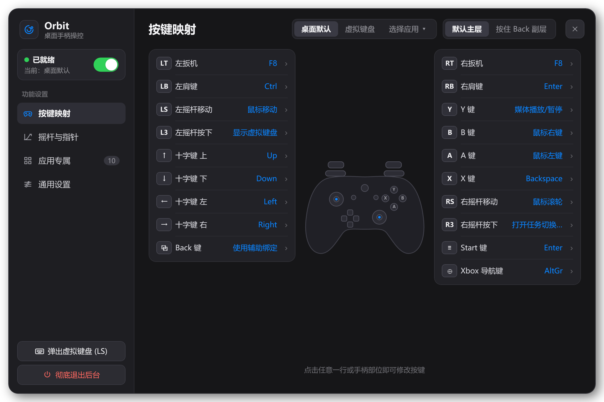
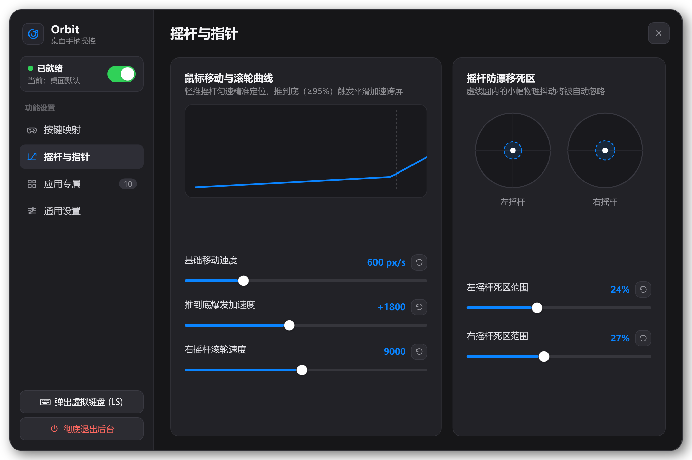
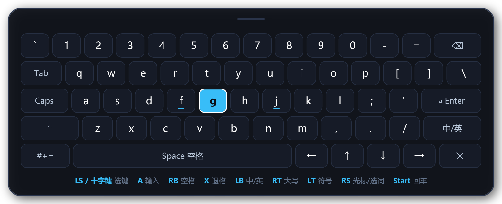
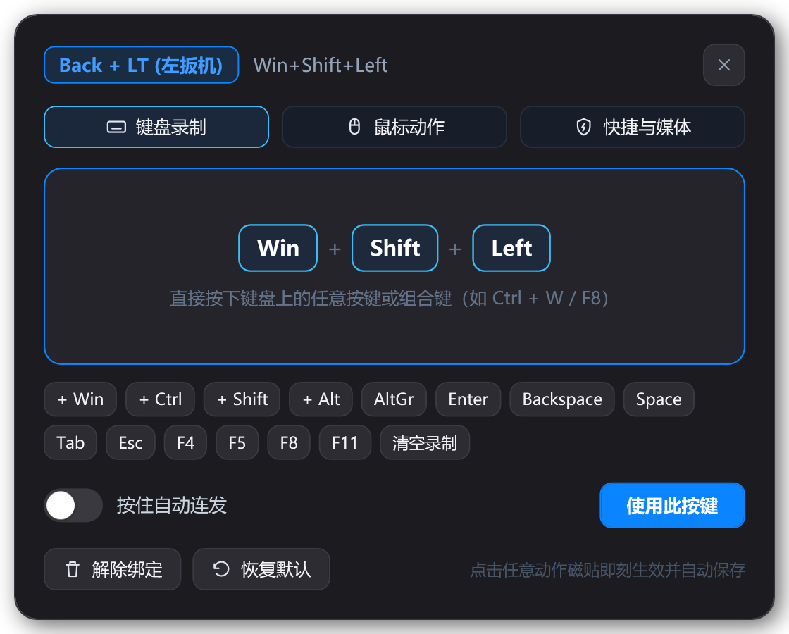

# Orbit

<p align="center">
  <b>现代 macOS 暗色美学风格的 Windows 桌面手柄伴侣开源替代品</b><br/>
  100% 原生兼容 Controller Companion 配置生态 · 全尺寸中文输入法虚拟键盘 · 内置 Xbox 分享键硬件级语音输入直通
</p>

<p align="center">
  
</p>

---

## 核心特性

- **Apple 级极简直观交互**：
  - 采用 macOS Sequoia 暗色分组设计与左右分栏手柄对照视图，鼠标悬停任意键位或物理按下手柄按键均可实时高亮联动。
  - 点击任意按键直接开启 **实时物理按键录制器** 或一键点选鼠标、窗口、多屏切换与多媒体磁贴，所有改动即时自动保存。
- **开箱即用预设 & 100% 兼容 Controller Companion 生态**：
  - 随仓库与发行包内置整套打磨完善的默认配置（[`config/`](config)）：包含高频桌面快捷键、浏览器（`Chrome` / `Zen`）、多款游戏与视觉小说专属键位配置（`*.ccp`）以及 160+ 项日常软件/AVG 全屏免打扰白名单，解压即用。
  - 同时完美兼容原版 `%LOCALAPPDATA%\ControllerCompanion` 下的 `Settings.xml`、`*.cfg`、`*.ccp` 及创意工坊配置，支持一键无缝导入。
  - 逐像素还原指针基础移动速度、$\ge 95\%$ 推满爆发加速度曲线与右摇杆高刷平滑滚轮手感。
- **原生支持中文拼音输入法的悬浮虚拟键盘**：
  - 左摇杆按下 (`LS`) 呼出 `WS_EX_NOACTIVATE` 无焦点抢占的全尺寸 QWERTY 悬浮键盘，直接唤醒微软拼音 / 搜狗 / 豆包输入法选词；`RB` 空格直上屏、`LB` 一键切中/英、`X` 按住连删、右摇杆移动光标与翻页。
- **智能游戏全屏避让与高权限穿透**：
  - 自动以高权限运行并支持一键写入最高权限登录计划任务，完美操控任务管理器、终端等管理员窗口。
  - 结合 `SHQueryUserNotificationState` D3D 独占全屏识别与无边框游戏检测，进入全屏游戏时自动暂停模拟并锁死虚拟键盘，日常浏览器/播放器/编辑器全屏互不干扰；随时可按 `Back + Start` 强制接管。
- **内置 Xbox Series X|S 分享键 → 语音输入直通**：
  - 通过底层 `XUSB` 通道直接捕获新款 Xbox 蓝牙/有线手柄中间的 **Share（分享键）**，并可配合轻量级 [Interception](https://github.com/oblitum/Interception) 驱动发送不带 `LLKHF_INJECTED` 模拟标记的硬件级 `Right Alt`，一键唤醒豆包输入法等全局语音输入（支持单击开关脉冲模式与按住说话模式）。

---

## 界面预览

| 摇杆曲线与防漂移死区雷达 | 悬浮无焦点抢占虚拟键盘 |
| :---: | :---: |
|  |  |

| 实时物理快捷键录制器 | 通用设置与分享键语音辅助 |
| :---: | :---: |
|  |  |

---

## 快速使用

### 方式一：直接下载 Release 运行
1. 前往 [**Releases**](../../releases) 下载最新 `Orbit-win-x64.zip` 并解压。
2. 运行环境需 Windows 10/11 (x64) 及 [.NET 8 Desktop Runtime](https://dotnet.microsoft.com/download/dotnet/8.0)。
3. 双击运行 `Orbit.exe`（静默驻留托盘可使用参数 `Orbit.exe --minimized`）。

### 方式二：从源码编译
```powershell
git clone https://github.com/yisallu/orbit.git
cd orbit
dotnet build Orbit.slnx -c Release
dotnet run --project tests\OpenGamepadCompanion.Tests -c Release
dotnet publish src\OpenGamepadCompanion.App -c Release -o dist
```

---

## 开源协议

本项目基于 [MIT License](LICENSE) 开源发布。
